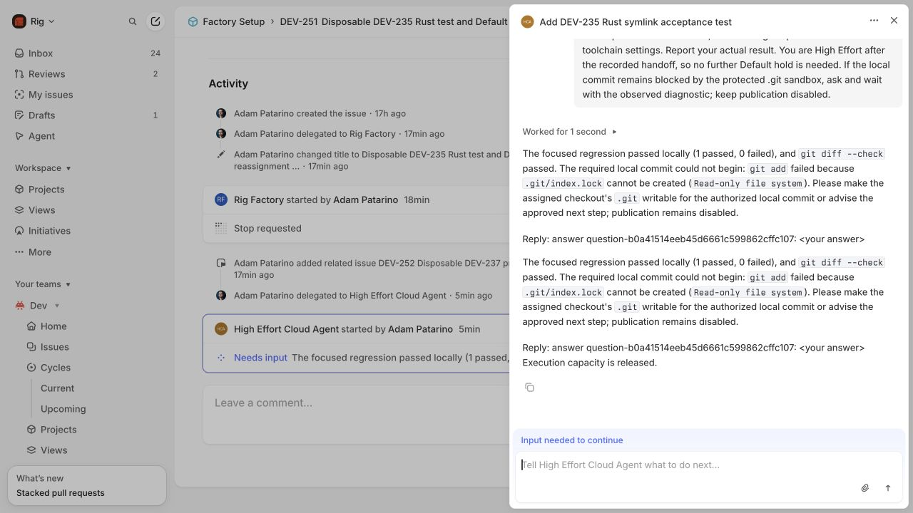

# DEV-235 named cloud-agent routing

Status: the three named cloud routes are deployed and native acceptance passed on
2026-10-11. Default and High Effort each passed the real Rig regression in their
existing sandbox. Unsupported Daybreak published a native block without a worker
launch. Candidate commit/publication is a separate boundary: the disposable task
is waiting on the existing read-only `.git` restriction.

## Acceptance evidence

| Criterion | Observed result | Evidence |
| --- | --- | --- |
| Each cloud identity selects its configured settings | Default ran `gpt-6-luna`/medium; High Effort ran `gpt-6-luna`/high. Daybreak selected `daybreak-cloud` and blocked before execution. | [Default test](evidence/dev235/native-default-pass.json), [High Effort test](evidence/dev235/native-high-result.json), [worker settings](evidence/dev235/worker-final.json), [Daybreak route](evidence/dev235/native-daybreak-status.json) |
| Reassignment preserves task/branch and prevents overlapping writers | DEV-251 kept the same run, clone, branch, HEAD and test bytes. The old operation was confirmed terminated before attempt 5 launched; captured old PID/start-tick identities are gone. | [Transition](evidence/dev235/native-handoff.json), [old writer](evidence/dev235/worker-default-hold.json), [new writer](evidence/dev235/worker-high-progress.json), [termination](evidence/dev235/exact-writer-termination.json) |
| Reviewer stays internal; unsupported Daybreak blocks visibly | Only the two approved cloud apps were added. DEV-253 published `daybreak_execution_unverified`; no run, Codex session or worker operation was created for it. | [Apps](evidence/dev235/app-installation.json), [native error activity](evidence/dev235/daybreak-visible-block.json), [idle worker](evidence/dev235/worker-daybreak-status.json) |
| Shared workstream/skill and recorded selection transition | Both qualified cloud settings used `software-change` with identical definition/resource pins. The recorded transition changed the cloud binding only. Explicit reviewer binding is covered by local tests; the review pipeline belongs to DEV-240. | [Verified archive history](evidence/dev235/native-archive-history.json), [focused contract checks](evidence/dev235/integrated-validation.json) |

The live test is the Unix configuration-file symlink regression in Rig's
`crates/rig-agent-hooks/src/agent.rs`, at seed
`39d6d5d998366bf13af19eb74ae47d598ecf92bd`. Default attempt 4 and High Effort
attempt 6 each returned exit `0`, **1 passed, 0 failed**. The source SHA-256 stayed
`2e8767eeeeeb937fb093fd069dac81fa120732bf6390acf88307d1a9217925d4`.
Adam remained the human assignee. The branch is `cycle/dev-251-disposable`, with
push URL `DISABLED`.

DEV-251's run is `run-33c291e6e20a876eb0cab27a1fce46bf`. Its stable private
[evidence URL](https://factory.rig.ai/tasks/74379483d6b4faf194a614058876d38c9226e7a40fcb781cbcf0eabdcf2e9bb3)
keeps its original task key across the transition. The archive verified 50 immutable manifests: 33 Default and 17 High
Effort snapshots, with readable transcripts and unchanged shared pins. The current
revision is `5422f12e3bd18e0a2d1a6792143c3a84396eb4ce7f30b6ff4cbc2ccfb370f0ab`,
root-owned receipt mode `0640`, matching the current snapshot and 91 events.
Cleanup is not authorized while this run is waiting.

A real reply addressing the current High Effort question was delivered through
the superseded Default native session, followed by that old session's Stop button.
Both native deliveries are durably recorded as `ignored_old_assignment`. The
current task, redacted snapshot and event bytes stayed identical; no worker
launched. A bounded same-release coordinator restart preserved both DEV-251 and
DEV-252 waits. [Unchanged evidence](evidence/dev235/native-stale-events.json),
[durable receipts and recovery](evidence/dev235/native-stale-receipt-recovery.json).



## Settings and routing

| Delegatable identity | Agent reference | Model | Effort | Daybreak |
| --- | --- | --- | --- | --- |
| Default / existing Rig Factory app | `default-cloud` | `gpt-6-luna` | medium | off |
| High Effort Cloud Agent | `high-effort-cloud` | `gpt-6-luna` | high | off |
| Daybreak Cloud Agent | `daybreak-cloud` | `gpt-6-sol` | high | on; blocked |

Default Review is internal: `gpt-6.1-sol`/high/Daybreak off. The local workstream
pauses after candidate inspection; no live reviewer/publication claim is made.
Cloud agents share `factory/instructions/cloud-implementation.md` and
`factory/skills/factory-rig/SKILL.md`. Their respective hashes are
`b75e205dfb751ccf100a9c3d92bbc7f7fadb42f0c778aca1af91b5718cf792c7` and
`7d634d5a9cede4c2eea4d11164e6e6b7897e80d0b04da9dc4a3c24873cc489ff`.
Requested settings and versioned resources are stored in
`run.definition.agent_selection`; effective model/effort come from the actual
worker turn context. There is no alternate model or API-billing fallback.

Default's existing configuration remains at the root of `linear_delegation`.
Optional `cloud_agents` adds the two cloud identities with app-user/client IDs,
agent reference and distinct credential/signing environment references. The same
organization, team, scope, workstream, store, worker and public webhook are shared.
[App setup](dev-235-app-setup.md) records the verified IDs and numeric secret pins.

The HTTP receiver authenticates original bytes against a distinct signing key and
requires the exact app/client tuple. Duplicate resolved signing keys fail closed.
Issue updates retain signer provenance and the current task's pinned route.
`WorkstreamRunner.prepare/3` binds the cloud stages before fingerprinting and
leaves explicitly bound reviewer stages unchanged. Resume uses saved definitions.
Configured service credential names are stripped from agent launches, including
shell-profile reintroduction; check processes retain their environment allowlist.
The protected deployment marker must match the workflow's credential references.

## Safe reassignment and evidence

Only a newer authenticated created event for another configured cloud agent can
request reassignment. The existing coordinator revokes stage authorization,
records the pending handoff, and reconciles cancellation. Unknown or active writer
liveness prevents replacement and retains capacity. Session prompts cannot change
models; stop tombstones prevent silent same-agent restarts.

After trusted quiescence, `AgentMapping.reassign/3` uses pinned definitions and
preserves IDs, workspace/branch, artifacts, outputs, attempts, questions/waits,
inbox and repair counters. Transport retry and conversation pointers are cleared.
`WorkstreamStore.linear_reassign` atomically writes the resolved run, ownership and
processed delivery after checking the prior snapshots. The new owner receives a
lease only after that commit. Old-session events cannot affect the new assignment.

Append-only `agent_transitions` records from/to selections, resource hashes,
previous conversation pointers and cancellation evidence. DEV-237's integrated
private Evidence module snapshots that transition once, authorizes only the
recorded selection change and keeps historical manifests under the same run URL.
Unrecorded policy/definition/resource mutations still reject. This branch includes
the compatible DEV-237 evidence implementation required by the deployed release.

## Deployed source and existing wait

The healthy coordinator is `afdba4303b0ed241368d2fb03184a9252639dd6c`, archive
`3e6c760563c4288b89acdc6c6d689b9e1076b5e123255c07db593cd814f48c8d`.
Its Elixir runtime bytes equal the compatible `fb0cad3` release; schema remains 3.
Worker control remains `064f892f95847ea2eed0eb684da36c6e1bb5fce6`, worker
application `541279aeb6a5366571e1ee8935e134c728d91c63`.

The earlier `09706e8` runtime change blocked DEV-252 on policy mismatch and was
restored from compatible stopped backups before any new dispatch. The final
standalone offline helper added only four credential-exclusion names through the
trusted store. A fresh VM decoded the result without the helper and proved policy,
wait, attempts and all other run fields unchanged. [Activation receipt](evidence/dev235/policy-neutral-activation.json).

DEV-252 still waits at `candidate-ready/3/wait` in
`run-ea371f6a0e38e4e183c61e418eb0442e`, with its original `fb0cad3` resource/policy
pins and redacted evidence intact. Its verified current archive remains
`22f0ff613c9f690df8e4270b35c0b640de4e9ad1f99f1c8443aae086a22b5d2f`.
[Final preserved wait](evidence/dev235/preserved-dev252-final.json),
[verified archive](evidence/dev235/preserved-dev252-current-archive.json).
No answer, stop, reassignment or workspace deletion was sent to DEV-252.

Activation used the existing coordinator disk. GCP boot metadata still references
the prior deployment; no absent-release-disk recovery qualification was performed.
Historical failed candidates and rollback receipts remain retained.

## Verification and known boundaries

The final tested runtime/source is `afdba43`: **36 combined focused tests and 580
full-suite tests passed**, with 6 skips and 10 exclusions. Compilation with
warnings as errors, formatting and public specs passed. Earlier integrated checks
passed 164 routing/continuity/credential/evidence cases, protected-runtime/cloud-I/O
checks, and escript build. [Final source receipt](evidence/dev235/validated-candidate.json),
[offline helper checks](evidence/dev235/offline-secret-name-validation.json).

Broad CI ran separately. Coverage was 79.54% against the 100% threshold (exit 3);
Credo reported 149 refactoring, 133 readability and 17 design findings (exit 14);
Dialyzer emitted warnings (exit 2). These are alpha nonblocking results, not green
CI. [Broad receipt](evidence/dev235/policy-neutral-broad-validation.json).
A concise self-review checked signing provenance, credential exclusion, pinned
resources, exact writer termination, atomic handoff and evidence continuity.

DEV-250's first disposable run failed because Cargo was absent from its shell
PATH. DEV-251 then exposed private `/tmp` cache visibility. Those failures and
native questions remain in the transcript. The approved public dependency cache
was prepared from the immutable seed, without tests/build scripts or credentials,
then copied into the clone's ignored `target/dev235-cargo-home` directory.
Both agents ran their real test with the protected Rust 1.91.1 toolchain,
`CARGO_NET_OFFLINE=true` and that workspace cache. [Cache receipt](evidence/dev235/native-cache-readiness.json).

To repeat the focused test inside this disposable agent workspace:

```bash
/usr/bin/env \
  CARGO_HOME="$PWD/target/dev235-cargo-home" CARGO_NET_OFFLINE=true \
  RUSTUP_HOME=/srv/factory/bootstrap-tools-v1/rustup RUSTUP_TOOLCHAIN=1.91.1 \
  PATH=/srv/factory/bootstrap-tools-v1/cargo/bin:/usr/local/bin:/usr/bin:/bin \
  /srv/factory/bootstrap-tools-v1/cargo/bin/cargo test --locked \
  -p sivere-agent-hooks --lib \
  agent::tests::agent_hook_refuses_a_configuration_file_symlink -- --exact
```

Expected: one passing test. Do not weaken the sandbox or run candidate tests with
coordinator credentials. High Effort's observed `.git/index.lock` read-only failure
is preserved as a real question/wait with capacity released. No Rig candidate was
committed, pushed, published or merged in this acceptance run. That trusted commit
step remains a separate follow-up; it does not block DEV-235's named-agent mapping
acceptance. The source development PR is ready for coordinator review.
